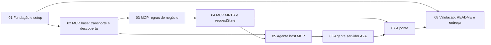

# Plano Geral — A Ponte

> Visão executiva do desafio e mapa de execução por fases. Produzido pelo prompt mestre
> [docs/plans/00-prompt-mestre-planejamento.md](plans/00-prompt-mestre-planejamento.md).
> **Fonte de verdade final: `validador/validar.py` (36 verificações).** Onde o enunciado e o
> validador divergirem, o validador vence.

---

## 1. Sumário do desafio

Construir **dois processos separados**, que conversam por HTTP, e a **ponte** de estado entre eles:

- **Servidor MCP** (porta `7301`, Streamable HTTP em `/mcp`): três tools (`listar_salas`,
  `consultar_disponibilidade`, `reservar_sala`), um resource (`politica://uso`), os dois tipos de
  erro (execução com `isError: true` e protocolo com `error` JSON-RPC) e o ciclo **MRTR** na reserva.
- **Agente** (porta `7300`): é **host MCP por dentro** (descobre e chama as tools do servidor por
  HTTP) e **servidor A2A por fora** (Agent Card em `/.well-known/agent-card.json`, endpoint `/a2a`
  com `SendMessage` e `GetTask`, Task como máquina de estados).
- **A ponte**: quando o MCP responde `input_required`, o agente pausa a Task em
  `TASK_STATE_INPUT_REQUIRED`, guarda o `requestState` ligado àquela Task e, na continuação, repete o
  `tools/call` com **id de JSON-RPC novo**, levando `inputResponses` e o `requestState` ecoado.

O domínio é fixo e entregue pronto em `dados/`. **Sem LLM, sem sessão, sem banco.** O foco é protocolo.

---

## 2. Prova de ingestão das fontes de verdade (§6 do prompt mestre)

| Arquivo | Resumo de 1 linha |
|---|---|
| `docs/challenge.md` | Enunciado oficial: 2 processos, 3 tools, MRTR, A2A, a ponte, 36 verificações, critérios de aceite. |
| `README.md` | Réplica do challenge no starter (mesmo conteúdo). |
| `validador/validar.py` | 36 checks: 1–20 falam MCP por HTTP, 21–36 falam A2A; usa `PROTOCOLO=2026-07-28`, `CAP={"elicitation":{"form":{}}}`, `POLITICA=2026-11-01`, trace-id aleatório. |
| `validador/README.md` | Rodar com processos recém-subidos; restart do MCP e `traceparent` no stderr ficam no fluxo manual. |
| `exemplos/wire/01-tools-list.json` | `tools/list` → `resultType: complete`, 3 tools com `inputSchema` objeto e `outputSchema`. |
| `exemplos/wire/02-tools-call-livre.json` | Reserva livre → `complete`, `structuredContent` com `reserva/reservado/sala/inicio/fim/responsavel/politica/motivo`. |
| `exemplos/wire/03-...conflito-input-required.json` | Conflito → `resultType: input_required`, `inputRequests` (chave `__main__:escolha_de_sala`), `requestState` (prefixo `v1.`). |
| `exemplos/wire/04-tools-call-retry.json` | Retry com id novo (`id:4`), `inputResponses` + `requestState` → reserva concluída `res-0004`. |
| `exemplos/wire/05-resources-read-politica.json` | `resources/read politica://uso` → `contents[0].text` com `versao: 2026-11-01`, `mimeType: text/markdown`. |
| `exemplos/wire/06-erro-32021-sem-elicitation.json` | `clientCapabilities: {}` → HTTP 400, `error.code: -32021`, `data.requiredCapabilities`. |
| `exemplos/wire/07-a2a-agent-card.json` | Card v1.0: `supportedInterfaces[].protocolBinding: JSONRPC`, `protocolVersion: 1.0`, skill `reservar-sala`. |
| `exemplos/wire/08-a2a-send-message.json` | `SendMessage` (sala ocupada) → Task `TASK_STATE_INPUT_REQUIRED`, msg `alternativas: ...`. |
| `exemplos/wire/09-a2a-get-task-input-required.json` | `GetTask` → task com `status.state`, `status.message`, `history[]`, `artifacts: []`. |
| `exemplos/wire/10-a2a-send-message-continuacao.json` | Continuação `escolha=sala-mirante` → `TASK_STATE_COMPLETED`, artifact `reserva`. |
| `exemplos/wire/11-tools-call-retry-recusa.json` | `action: decline` → `complete`, `isError: false`, `reservado: false`, `motivo: "recusado"`. |
| `dados/salas.json` | 5 salas: aquario(4), porao(6), garagem(12), fusca(12), mirante(20). |
| `dados/reservas.json` | 2 reservas iniciais: garagem 14–15h, fusca 16–17h, dia 2026-11-03. |
| `dados/politica-de-uso.md` | `versao: 2026-11-01`; janela 08:00–20:00; máx 2h; sem sobreposição. |

---

## 3. Invariantes do desafio

**Fixos (não interpretar):**

- Portas: agente `7300` (`/a2a`, `/.well-known/agent-card.json`); MCP `7301` (`/mcp`).
- Protocolo MCP: `2026-07-28`. Capability do cliente: `{"elicitation": {"form": {}}}`.
- Pedido A2A: `reservar sala=<id> inicio=<iso8601> fim=<iso8601> responsavel=<nome>`.
- Continuação A2A: `escolha=<id da sala>` ou `escolha=recusar`.
- Linha de pausa (byte a byte): `alternativas: <ids separados por vírgula e espaço>`, na ordem do `enum`.
- Alternativas: salas livres no intervalo com capacidade **≥** a da sala pedida, no máx **3**, ordenadas por
  **capacidade crescente** e, em empate, por **id alfabético**.
- Nomes fixos: skill `reservar-sala`; artifact `reserva`; resource `politica://uso`; tools
  `listar_salas`, `consultar_disponibilidade`, `reservar_sala`.
- Versão da política usada no artifact: `2026-11-01` (lida da 1ª linha do resource).
- Mensagens de erro de execução (literais, sem acento):
  - `Sala inexistente: <id>`
  - `Fora da janela de uso: a politica permite reservas entre 08:00 e 20:00`
  - `Duracao acima do limite: a politica permite no maximo 2 horas`
  - `Intervalo invalido: fim deve ser posterior a inicio`
  - `Sem alternativas disponiveis no intervalo`
- Códigos de protocolo: `-32602` (_meta faltando / URI inexistente / requestState inválido / tool
  inexistente*), `-32021` (falta capability elicitation form), `-32020` (header não bate com o corpo).
  *tool inexistente aceita `-32602` **ou** `isError: true`.

**Livres:** linguagem (Python `mcp` ou Node `@modelcontextprotocol/server`), estrutura interna,
texto da chave do `inputRequests`, mensagens de conclusão amigáveis.

**Proibidos:** alterar `dados/`, `validador/`, `exemplos/`; LLM no caminho; sessão (inferir
versão/capabilities de request anterior); abrir/interpretar o `requestState`; colapsar os dois
processos; segredo hardcoded.

---

## 4. As três fricções propositais (riscos de primeira classe)

1. **MRTR não é callback.** O transporte stateless não tem canal de volta. O servidor **não chama**
   o cliente no meio da tool: ele **termina a resposta** com `resultType: input_required`. No SDK
   Python, procurar `input_required`; no de TS, `inputRequired`. Sintoma do erro: "transporte sem
   canal de volta para requests iniciados pelo servidor". → Fases 04, 05, 07.
2. **`-32021` por falta de capability.** Elicitation só pode ir para cliente que declarou
   `{"elicitation": {"form": {}}}` no `_meta`. Faltou → `-32021` + HTTP 400 + `data.requiredCapabilities`.
   → Fases 04, 05.
3. **`requestState` é entrada controlada por atacante.** Deve ser **assinado** (HMAC/AEAD), com
   expiração 5–30 min, **restart-safe**, segredo em `REQUEST_STATE_SECRET` (≥32 bytes). Base64 puro
   reprova. Trocar 1 caractere → `-32602`. → Fase 04.

---

## 5. Sequência de fases e dependências

| Fase | Documento | Entrega-núcleo |
|---|---|---|
| 01 | [fase-01-fundacao-e-setup.md](fase-01-fundacao-e-setup.md) | Fork, estrutura, stack, versões travadas, scripts de subida. |
| 02 | [fase-02-mcp-base-transporte-e-descoberta.md](fase-02-mcp-base-transporte-e-descoberta.md) | Streamable HTTP, `_meta`/400, `tools/list`, `listar_salas`, resource, log stderr. |
| 03 | [fase-03-mcp-regras-de-negocio.md](fase-03-mcp-regras-de-negocio.md) | `consultar_disponibilidade`, reserva feliz, 4 erros de execução. |
| 04 | [fase-04-mcp-mrtr-e-requeststate.md](fase-04-mcp-mrtr-e-requeststate.md) | `input_required`, elicitation, `requestState` assinado, `-32021`, `-32602`, recusa. |
| 05 | [fase-05-agente-host-mcp.md](fase-05-agente-host-mcp.md) | Cliente MCP puro: descoberta, resource, `_meta`, headers, traceparent. |
| 06 | [fase-06-agente-servidor-a2a.md](fase-06-agente-servidor-a2a.md) | Agent Card, `SendMessage`/`GetTask`, máquina de estados, artifact. |
| 07 | [fase-07-a-ponte.md](fase-07-a-ponte.md) | Pausa, guarda do `requestState`, retomada com id novo, recusa, concorrência. |
| 08 | [fase-08-validacao-readme-e-entrega.md](fase-08-validacao-readme-e-entrega.md) | 36 verificações verdes, fluxo manual, README, push na `main`. |

---

## 6. Matriz de rastreabilidade — Critério de Aceite → Fase → Verificação

### Servidor MCP
| Critério de Aceite | Verif. | Fase | Evidência de pronto |
|---|---|---|---|
| Sobe na 7301 e `tools/list` traz as 3 tools | 1 | 02 | `tools/list` → `listar_salas`, `consultar_disponibilidade`, `reservar_sala` |
| Toda tool tem `inputSchema` objeto | 2 | 02 | `inputSchema.type == "object"` nas 3 |
| `listar_salas` → `structuredContent` == JSON do bloco de texto | 3 | 02 | `json.loads(bloco) == structuredContent` |
| `_meta` sem `protocolVersion`/`clientCapabilities` → `-32602` + 400 | 4, 5 | 02 | HTTP 400, `error.code == -32602` |
| `tools/call` de tool inexistente recusado | 6 | 02 | `-32602` **ou** `isError: true` |
| `resources/read politica://uso` ok; URI inexistente → `-32602` | 7, 8 | 02 | `POLITICA in contents[0].text`; URI ruim → `-32602` |
| 4 erros de execução com mensagem exata | 9–12 | 03 | `isError: true` + texto literal |
| stderr registra método, id e `traceparent` | (manual) | 02 | linha no stderr por request |

### MRTR
| Critério de Aceite | Verif. | Fase | Evidência |
|---|---|---|---|
| Conflito → `input_required` + 1 `inputRequests` + `requestState` | 13 | 04 | `resultType == "input_required"` |
| `requestedSchema` plano, enum na ordem | 14 | 04 | `enum == ["sala-fusca","sala-mirante"]`, `mode: form` |
| Sem capability → `-32021` + `requiredCapabilities` + 400 | 15 | 04 | `error.code == -32021`, HTTP 400 |
| Retry conclui a reserva (`complete`) | 16 | 04 | `resultType == "complete"`, `structuredContent.sala` ok |
| `requestState` adulterado → `-32602` | 17 | 04 | troca de 6 chars finais → `-32602` |
| Argumentos adulterados não tomam efeito | 18 | 04 | valores selados vencem **ou** erro |
| Retry válido funciona após restart do MCP | (manual) | 04 | `requestState` restart-safe |
| Segredo em `REQUEST_STATE_SECRET` (≥32B), nada hardcoded | (revisão) | 04 | sem segredo no código |
| Recusa (`decline`) conclui sem reservar, sem `isError` | 19 | 04 | `reservado: false`, `motivo: "recusado"` |
| Sem alternativa → `isError` + "Sem alternativas disponiveis no intervalo" | 20 | 04 | texto literal |

### Agente como host MCP
| Critério de Aceite | Verif. | Fase | Evidência |
|---|---|---|---|
| `tools/list` antes do 1º `tools/call` | (stderr) | 05 | ordem no log do MCP |
| `traceparent` com mesmo trace-id do validador | (stderr) | 05 | trace-id propagado |
| Requests do agente declaram `elicitation.form` | (stderr/15) | 05 | `_meta` com capability |

### Agente como servidor A2A
| Critério de Aceite | Verif. | Fase | Evidência |
|---|---|---|---|
| `GET /.well-known/agent-card.json` → 200 v1.0 | 21 | 06 | JSON do card |
| Card: interface JSON-RPC + versão 1.0 + skill `reservar-sala` | 22, 23 | 06 | `supportedInterfaces`, `skills[].id` |
| `SendMessage` sala livre → `COMPLETED` + artifact `reserva` | 24, 25 | 06 | `politica == 2026-11-01`, `sala` ok |
| `GetTask` devolve id, contextId, estado, artifact | 26 | 06 | campos presentes |
| `SendMessage` em Task terminal recusado | 31 | 06 | `error` presente |
| Sala inexistente → `FAILED` com a mensagem da tool | 35 | 06 | `TASK_STATE_FAILED`, `Sala inexistente:` |

### A ponte
| Critério de Aceite | Verif. | Fase | Evidência |
|---|---|---|---|
| Sala ocupada → `INPUT_REQUIRED` + `alternativas: ...` na ordem | 27, 28 | 07 | `alternativas: sala-fusca, sala-mirante` |
| Continuação `escolha=<id>` → `COMPLETED` na sala escolhida | 30 | 07 | `sala == escolha` |
| `escolha=recusar` → `CANCELED` | 32 | 07 | `TASK_STATE_CANCELED` |
| Escolha fora do enum mantém `INPUT_REQUIRED` | 29 | 07 | estado inalterado |
| Duas Tasks pausadas concluem cada uma com sua reserva | 33 | 07 | `reserva` e `inicio` distintos |
| `requestState` não vaza em resposta A2A | 34 | 07 | ausente nos corpos A2A |
| Determinismo: mesmo pedido → mesma pausa | 36 | 07 | `m1 == m2`, começa com `alternativas:` |

### Validação e entrega
| Critério de Aceite | Verif. | Fase | Evidência |
|---|---|---|---|
| 36 verificações verdes, exit 0, processos recém-subidos | 1–36 | 08 | saída do validador |
| `dados/`, `validador/`, `exemplos/` intactos | (git) | 08 | `git status` limpo nesses paths |
| Determinístico, sem SDK de LLM | 36 | 08 | sem dependência de LLM |
| README com as 4 seções, comandos de clone limpo | (revisão) | 08 | README completo |

> **Cobertura:** as 36 verificações estão atribuídas (1–8→F02, 9–12 e 20→F03/F04, 13–19→F04,
> 21–26,31,35→F06, 27–30,32–34,36→F07, e 1–36 revalidadas em F08). Os itens "manuais/stderr/git"
> (restart, traceparent no log, integridade do segredo, pastas intactas) estão cobertos nas fases
> indicadas. Nenhum critério ficou órfão.

---

## 7. Divergências e decisões

- **Pausa mostra 1 ou 2 alternativas?** Os wire `08`/`09`/`10` mostram `alternativas: sala-mirante`
  (cenário em que `sala-fusca` já estava reservada). O validador, no check 28, parte do estado limpo
  e espera `alternativas: sala-fusca, sala-mirante`. **Decisão:** a linha é sempre derivada do `enum`
  da elicitation daquela execução; não fixar a lista. O validador é a verdade.
- **Chave do `inputRequests`.** O exemplo usa `__main__:escolha_de_sala` (gerado pelo SDK Python). É
  **livre**; o cliente só precisa devolver a **mesma** chave. Não fixar.
- **`structuredContent` da reserva.** Inclui `motivo` (null no sucesso, `"recusado"` na recusa), além
  dos campos citados no enunciado. Reproduzir conforme wire `02`/`04`/`11`.
- **Escolha da stack (Python vs Node):** **DECIDIDA na Fase 01 → Python.** O SDK oficial do MCP **v2
  (`mcp==2.3.0`, revisão 2026-07-28)** existe e traz o MRTR de primeira classe (`input_required`,
  `inputRequests`, `requestState` via `RequestStateSecurity` AES-256-GCM) e o Streamable HTTP. Os
  exemplos de wire foram capturados dessa mesma stack (chave `__main__:escolha_de_sala`,
  `requestState` com prefixo `v1.`), confirmando o menor atrito em Python. O **servidor** usa o SDK; o
  **agente** usa um cliente MCP raw (JSON-RPC sobre HTTP, só biblioteca padrão) para enxergar o
  `input_required` cru e ecoar o `requestState` opaco sem um callback respondendo sozinho.

---

## 8. Como as próximas fases devem ser executadas

Cada agente de fase deve conseguir trabalhar lendo **apenas** o documento da sua fase + as fontes de
verdade. Ao concluir uma fase: rodar a Definição de Pronto, e abrir a próxima. A validação ponta a
ponta só é exigida na Fase 08, mas rodar o validador parcialmente ao fim de 02/03/04 acelera o debug.

---

## 9. Histórico de execução (entrega)

> Registro cronológico do que foi efetivamente implementado e verificado. **Resultado final:
> 36/36 verificações do validador em PASS, `exit code 0`.** Nenhuma pendência em aberto.

### Decisões tomadas durante a execução
- **Stack = Python + SDK oficial `mcp==2.3.0`** (servidor) e **biblioteca padrão** (agente). Ver §7.
- **Linha de pausa derivada do `enum`** da execução (não fixa): confirmado pelo validador (check 28
  espera `alternativas: sala-fusca, sala-mirante` em estado limpo).
- **`requestState` protegido por AES-256-GCM** do SDK (`RequestStateSecurity`), `ttl=900s` (15 min),
  segredo só em `REQUEST_STATE_SECRET` (≥32 bytes). Restart-safe comprovado manualmente.

### Fases concluídas

| Fase | O que foi feito | Artefatos | Verificações |
|---|---|---|---|
| **01 — Fundação e setup** | Decisão de stack; `.venv` com `mcp==2.3.0`; `pyproject.toml` em `servidor-mcp/` e `agente/` (versões travadas, sem LLM); `.env.example`; scripts `subir-mcp.sh`, `subir-agente.sh`, `scripts/validar-e2e.sh`. | `servidor-mcp/pyproject.toml`, `agente/pyproject.toml`, `.env.example`, `subir-*.sh` | — (base) |
| **02 — MCP base** | Streamable HTTP em `/mcp:7301` via `MCPServer` (`json_response=True`); 3 tools declaradas; `listar_salas` com `structuredContent`+texto idênticos; resource `politica://uso` (`text/markdown`); `_meta` → `-32602`/400 (SDK); log em stderr (método, id, traceparent) por middleware. | `servidor-mcp/server.py`, `servidor-mcp/dominio.py` | 1–8 PASS |
| **03 — MCP regras** | `consultar_disponibilidade` e `reservar_sala` (caminho feliz); validações sala/intervalo/janela/duração na ordem exata; 4 erros de execução com mensagens literais; `structuredContent` da reserva. | `servidor-mcp/dominio.py` (`validar_pedido`, `Reservas`) | 9–12 PASS |
| **04 — MRTR** | Resolver `__main__:escolha_de_sala`: livre→reserva direto, ocupado→elicitation form com `enum` ordenado (cap. crescente, id alfabético), sem alternativa→`isError`; `requestState` selado (AES-GCM); `-32021` sem capability; `-32602` adulterado; recusa `decline`; **restart-safe** verificado. | `servidor-mcp/server.py` (`escolha_de_sala`, `reservar_sala`) | 13–20 PASS |
| **05 — Agente host MCP** | Cliente MCP raw (JSON-RPC/HTTP): `tools/list` no startup antes do 1º `tools/call`; leitura do resource e extração da versão; `_meta` com `elicitation.form` + headers espelhados; propagação do `traceparent` (mesmo trace-id, span novo); `isError`→mensagem preservada. | `agente/agent.py` (`mcp_call`, `_descobrir_com_retry`) | base p/ 35 |
| **06 — Agente A2A** | Agent Card v1.0 em `/.well-known/agent-card.json` (`supportedInterfaces`/`protocolBinding JSONRPC`/`1.0`, skill `reservar-sala`); `/a2a` com `SendMessage`/`GetTask`; máquina de estados da Task; artifact `reserva` com `politica`; Task terminal recusa `SendMessage`; sala inexistente→`FAILED`. | `agente/agent.py` (`agent_card`, `Handler`, `_abrir`) | 21–26, 31, 35 PASS |
| **07 — A ponte** | `input_required`→`TASK_STATE_INPUT_REQUIRED` com `alternativas: ...` na ordem do enum; `requestState` guardado em `_PAUSAS[task_id]` (nunca exposto); continuação com id de JSON-RPC novo e `requestState` ecoado; `escolha=recusar`→`CANCELED`; escolha fora do enum mantém pausa; isolamento por Task; determinismo. | `agente/agent.py` (`_tratar_resposta_mcp`, `_continuar`, `mcp_retry`) | 27–30, 32–34, 36 PASS |
| **08 — Validação, README, entrega** | Validação ponta a ponta do zero (36/36, exit 0); restart-safe e traceparent no stderr conferidos; `README.md` substituído com as 4 seções + saída do validador; `dados/`/`validador/`/`exemplos/` intactos; commit e push na `main`. | `README.md`, `scripts/validar-e2e.sh` | 1–36 PASS |

### Evidências
- **Validador:** `36 passaram, 0 falharam, de 36 verificacoes`, `exit code 0` (saída completa no `README.md`).
- **Restart-safe:** conflito → captura do `requestState` (`v1.…`) → restart do MCP → retry conclui
  (`resultType=complete`, `sala=sala-fusca`).
- **traceparent:** o trace-id impresso pelo validador aparece no stderr do servidor MCP; há
  `tools/list` antes do primeiro `tools/call`.

### Pendências
- Nenhuma. Todos os Critérios de Aceite obrigatórios atendidos e verificados.
